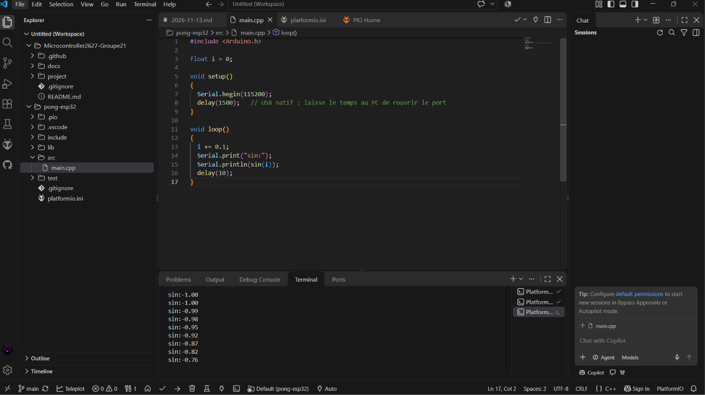
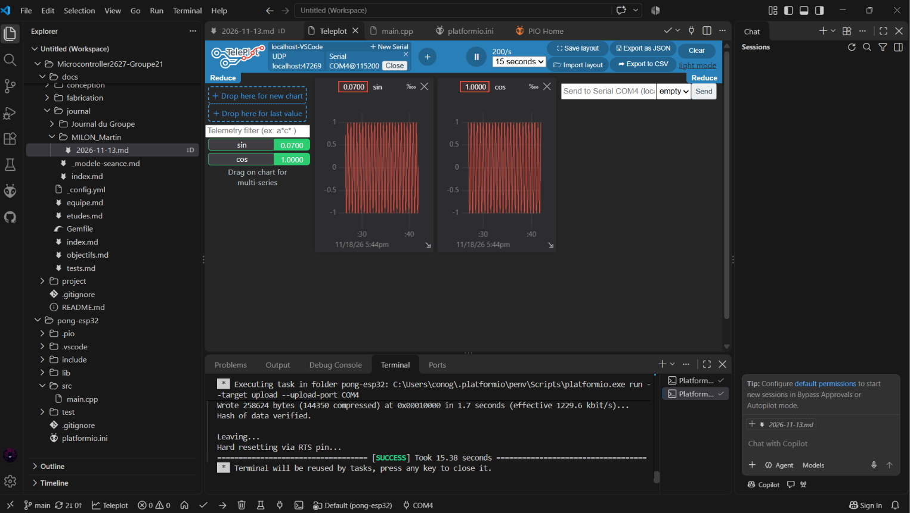

# 2026-11-18 : Test de réception d'informations de l'ESP32

**Séance :** 2 (planifiée) · **Durée :** 1 h 30

## Fait

Premiers essais de communication série via USB sur la carte en envoyant une trame (un signal sin) configurée à **115200 bauds**, affichée sur le moniteur série de PlatformIO.

Ensuite, utilisation de l'extension Teleplot via VS Code pour tracer la courbe (en ajoutant le préfixe > devant le nom de la variable).

## Pourquoi

Établir une première liaison série entre le PC et le microcontrôleur, comprendre la synchronisation de la vitesse (Serialbegin et monitorspeed) ainsi que l'utilité du delay dans le setup (nécessaire pour laisser le temps au PC de rouvrir le port COM après un reset lié à l'USB natif de l'ESP32-S3).

## Problèmes rencontrés

Difficultés initiales à faire reconnaître correctement le port COM par le PC, suivies d'une impossibilité d'afficher la courbe sous Teleplot car le port série était déjà accaparé par le terminal du moniteur série de VS Code.

## Reste à faire

Continuer à suivre les consignes du TD (affichage de plusieurs courbes simultanées et de donnée simultanément) et commencer à tester les différents composants.