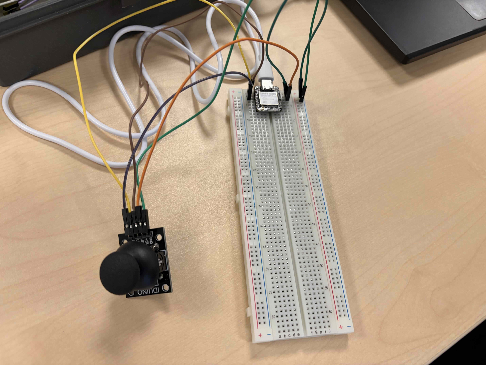

# 2026-11-19 : Test individuel des modules de la mallette sur breadboard

**Séance :** 3 (planifiée) · **Durée :** 1 h 30

## Fait

- **Analyse matérielle et brochage :** Identification des broches de la carte **Seeed Studio XIAO ESP32-S3** et des quatre modules de la mallette (bouton poussoir, joystick analogique, buzzer et écran TFT SPI ST7789) en respectant l'alimentation impérative en **3,3 V**.
- **Câblage du module joystick :** Montage sur plaque d'essai (breadboard) du joystick analogique en reliant l'alimentation (`3V3` / `GND`) ainsi que les sorties analogiques `VRx` sur **D0 (ADC0)** et `VRy` sur **D1 (ADC1)** (et `SW` sur **D2**).

- **Lecture des valeurs brutes :** Écriture et téléversement d'un programme de test sous PlatformIO afin de lire les variations des axes X/Y et l'état du bouton du joystick via le moniteur série.

## Pourquoi

L'objectif de cette séance est de valider individuellement le câblage, la tension de fonctionnement (3,3 V maximum pour ne pas endommager les entrées de l'ESP32-S3) et le comportement logiciel de chaque module sur breadboard. Utiliser dès maintenant le brochage définitif de la future console permet de garantir que le code développé aujourd'hui fonctionnera sans modification sur le circuit imprimé final.

## Problèmes rencontrés

- **Documentation technique :** Difficulté initiale pour retrouver le brochage exact et les fiches techniques des composants de la mallette.
- **Matériel de câblage :** Temps nécessaire pour trier et trouver les câbles Dupont adaptés (connexions mâle-femelle et mâle-mâle) afin de relier les modules à la breadboard.

## Reste à faire

- Terminer la calibration et la normalisation des valeurs du joystick (étapes 3 et 4 du TP).
- Câbler et tester individuellement les trois autres modules de la mallette : le **bouton poussoir** (`D5`), le **buzzer** (`D3`) et l'**écran TFT** (`D8` / bus SPI).
- Réaliser le test d'intégration global réunissant les quatre modules simultanément.